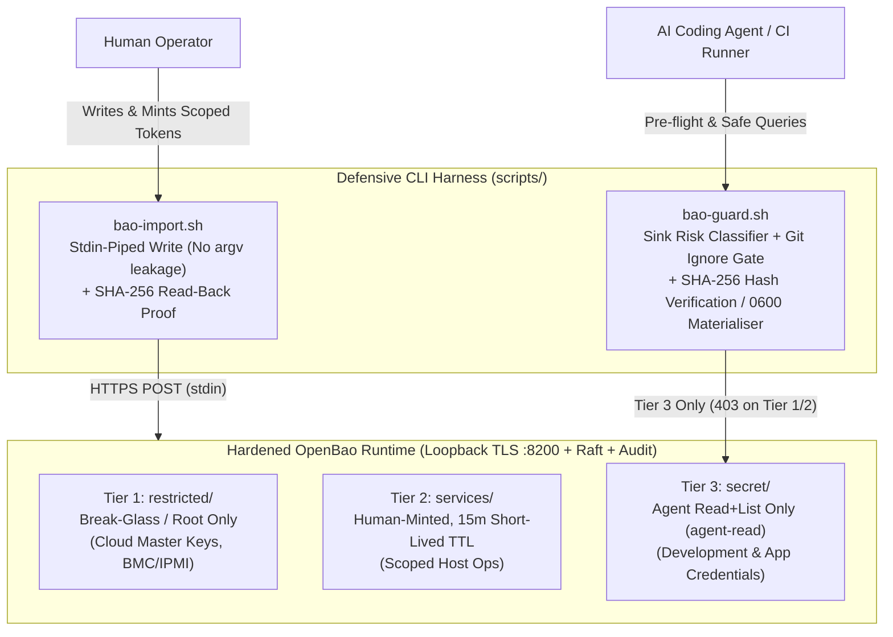

# openbao-agent-guard — Hardened OpenBao Runtime & Zero-Leak Secret Guard for AI Agents

[](https://github.com/betaucourt/openbao-agent-guard/actions)
[](./LICENSE)
[](https://openbao.org/)
[](#security-guarantees)

A hardened, local-first **OpenBao** (Vault-compatible) secret management runtime paired with a defensive CLI harness (`bao-guard.sh`, `bao-import.sh`, `openbao-setup.sh`) engineered to prevent **AI coding agents** (Claude Code, Cursor, Hermes, CI runners) from leaking credentials into LLM context windows, session transcripts, or process tables.

---

## Why This Exists: The AI Agent Secret Leak Problem

When autonomous AI coding agents interact with infrastructure or application configurations:
1. **LLM Context Window Poisoning**: Running `cat .env` or `echo $SECRET` permanently writes plaintext secrets into JSONL transcripts and cloud telemetry.
2. **Process Argument Leakage (`argv` / `ps aux`)**: Passing secrets via CLI flags (`jq --arg v "$SECRET"` or `curl -d`) exposes credentials in the operating system process table to any local process.
3. **Tracked Git Working Trees**: Temporarily writing unencrypted secrets into project directories risks accidental staging and committing to Git.

`openbao-agent-guard` enforces a strict **Zero-Knowledge / Zero-Display** boundary between the secret store and the agent execution environment.

---

## Architecture & Three-Tier Isolation



---

## Security Guarantees

1. **No Secret in `argv` (`ps aux`)**: `bao-import.sh` passes secrets strictly via standard input (`stdin`) into `jq` and `curl`, preventing exposure in process inspection tools.
2. **Sink Risk Classification**: Commands attempting to print raw secrets to `stdout`, console, or logs are blocked at the harness level (`sink_risk: DISPLAY` rejects with exit code `3`).
3. **Universal Git Ignore Gate**: When secrets are materialized to disk, `bao-guard.sh` verifies `git check-ignore -q` to guarantee the destination file will never be committed. Materialized files enforce `umask 077` (`chmod 600`).
4. **Zero-Knowledge SHA-256 Proof**: Agents verify that local configuration files match vault records purely by comparing cryptographic digests (`SRC_HASH == STORED_HASH`), outputting `VERIFY MATCH — bytes identical, value never displayed`.

---

## Quickstart

```bash
# 1. Initialize local OpenBao runtime with Raft storage
./scripts/openbao-setup.sh

# 2. Safely import a secret via stdin (zero argv exposure)
printf 'my-super-secret' | ./scripts/bao-import.sh secret/apps/payment api_key -

# 3. Verify secret integrity purely by SHA-256 hash (never displayed)
./scripts/bao-guard.sh verify secret/apps/payment api_key /tmp/secret.env
```

---

## Quality & Automated Verification

- **Automated Security Test Suite**: `test/run-tests.sh` executes **7 distinct security test suites** validating policy isolation, sink blocking, git-ignore enforcement, and zero-leak guarantees.
- **ShellCheck CI**: Automated static analysis on all shell scripts.

---

## References & Upstream Sources

### Core Secret Engine & Identity Management
- **[OpenBao Project](https://openbao.org/)**: The open-source, community-governed identity and secret management platform hosted under the Linux Foundation (fork of HashiCorp Vault).
- **[OpenBao KV Secrets Engine v2 Specification](https://openbao.org/docs/secrets/kv/kv-v2/)**: API contract and data model powering versioned secret key-value pairs, metadata isolation, and rollback capabilities.
- **[OpenBao Access Control & HCL Policy Model](https://openbao.org/docs/concepts/policies/)**: Principle of least privilege path-based capability matching (`create`, `read`, `update`, `delete`, `list`).

### AI Agent Security & Threat Modeling
- **[OWASP Top 10 for Large Language Model Applications](https://owasp.org/www-project-top-10-for-large-language-model-applications/)**:
  - **LLM02: Sensitive Information Disclosure**: Prevention of unauthorized access and credential leakage via prompt generation and agent inspection.
  - **LLM06: Excessive Agency / Insecure Output Handling**: Mitigating risks when autonomous coding agents execute shell commands with unintended access rights.
- **Defense-in-Depth Agent Boundary Architecture**:
  - Process-level protection against `argv` inspection via `ps aux` (`stdin` passing).
  - Terminal sink classification blocking accidental `DISPLAY` printouts (`exit 3`).
  - Universal Git ignore boundaries (`git check-ignore -q`) preventing secret commits to version control.

## License

[MIT](./LICENSE) © Gauthier Betaucourt
